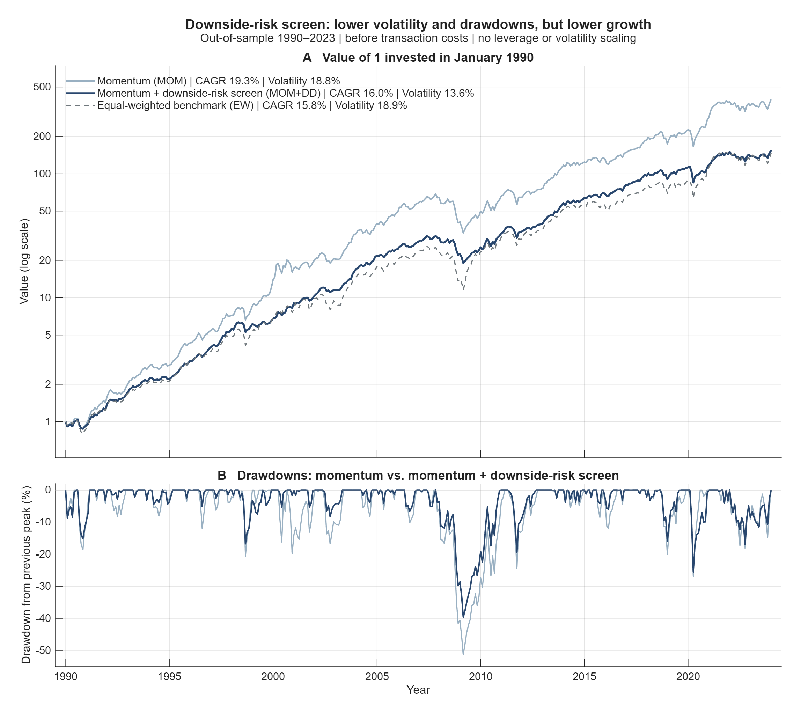
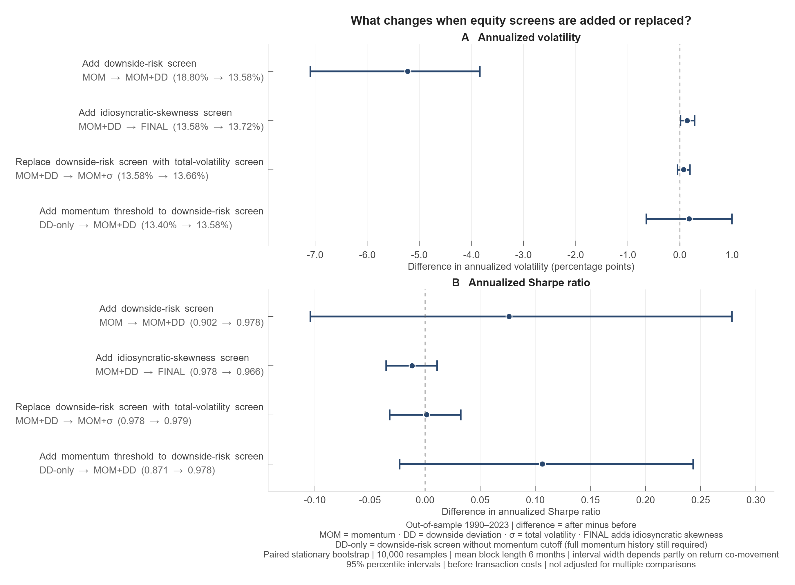

# Cross-Sectional Equity Signal Design and Evaluation

**Do downside-risk and idiosyncratic-skewness screens improve a momentum strategy, and what explains the change in risk?**

Momentum strategies have historically earned high average returns but can experience severe drawdowns. This study investigates whether two sequential return-based stock screens—low downside deviation and the exclusion of stocks with highly right-skewed idiosyncratic returns—improve a long-only momentum portfolio. Screening thresholds are calibrated over 1981–1989 and held fixed across 408 historical out-of-sample months (1990–2023). The analysis uses a paired stationary bootstrap, HAC-robust CAPM regressions and synthetic tests of signal timing and calibration isolation. The aggregate result files behind the reported tables are listed under [Result files](#result-files).

Adding the downside-risk screen reduced annualized volatility from 18.8% to 13.6% and maximum drawdown from −51.3% to −39.6%, but compound growth fell and the Sharpe ratio change (0.90 → 0.98) is not statistically distinguishable from zero. The subsequent idiosyncratic-skewness screen had a small portfolio-level effect and increased turnover. Further analysis associates 76% of the reduction in portfolio excess-return variance with lower fitted market beta. Replacing downside deviation with conventional total volatility gives a Sharpe difference close to zero.

## In short

Momentum selects stocks with the strongest returns over the preceding year, excluding the most recent month. The downside-risk screen retains momentum winners with lower downside deviation of daily excess returns. The final screen excludes stocks with the highest idiosyncratic skewness.

| Historical outcome | Momentum | + Downside-risk screen | + Skewness screen (FINAL) |
|---|---:|---:|---:|
| Annualized volatility | 18.8% | 13.6% | 13.7% |
| Worst peak-to-trough loss | −51.3% | −39.6% | −39.5% |
| Compound annual growth (CAGR) | 19.3% | 16.0% | 15.9% |
| Return per unit of risk (Sharpe ratio) | 0.90 | 0.98 | 0.97 |
| Average monthly one-way turnover | 23.7% | 32.3% | 34.6% |
| Average holdings | 334 | 134 | 120 |

*Out-of-sample 1990–2023, before transaction costs.*

- **Downside-risk screen — lower volatility, uncertain Sharpe improvement.** Realized volatility changed by −5.22 percentage points (95% bootstrap interval [−7.09, −3.84]). Observed CAGR fell and turnover rose; the 95% bootstrap intervals for both the CAGR and Sharpe differences include zero.
- **Skewness screen — small portfolio-level effect.** Adding the idiosyncratic-skewness screen changed Sharpe by −0.012 (95% bootstrap interval [−0.035, +0.011]) and annualized volatility by +0.14 percentage points (95% bootstrap interval [+0.01, +0.28]); turnover increased further.
- **Little evidence of a downside-specific effect.** In a CAPM decomposition, 76% of the reduction in portfolio excess-return variance is associated with lower fitted market beta (1.05 → 0.75). Replacing downside deviation with conventional total volatility yields a Sharpe difference close to zero (95% bootstrap interval [−0.032, +0.032]).

**Interpretation.** In this historical sample, the downside-risk screen behaved as a de-risking tilt: lower market beta and realized volatility, lower observed growth and higher turnover, without an established improvement in the Sharpe ratio.

**Scope:** A historical signal study, not an investable backtest. The restricted source panel was selected by an unknown method, so survivorship or selection bias cannot be ruled out. It uses an inherited ex-post availability convention, has unknown delisting-return treatment, and does not include transaction costs.

## Motivation and design choices

Momentum—buying recent winners—has strong empirical support ([Jegadeesh & Titman, 1993](https://doi.org/10.1111/j.1540-6261.1993.tb04702.x)) but is exposed to severe crashes ([Daniel & Moskowitz, 2016](https://doi.org/10.1016/j.jfineco.2015.12.002)). The research objective was to retain the momentum signal while investigating whether two additional screens could reduce the risk accumulated among recent winners.

The study deliberately explores how far systematic stock selection can go with a limited set of return-based signals, without company fundamentals or analyst forecasts. Momentum and downside deviation are computed from the source panel's stock returns, and idiosyncratic skewness additionally requires the market return to estimate CAPM residuals. The only data added to the source panel are the Fama–French factor files, which provide the market return and the daily risk-free rate. Market capitalization from the source panel is used for relative size buckets and the value-weighted panel benchmark.

Two considerations motivated the screening design.

1. **Downside risk.** Among momentum winners, the aim was to penalize stocks experiencing frequent or severe negative returns. Downside deviation was chosen as a simple, model-free measure that does not require estimating a market model; whether it captures anything beyond ordinary volatility is tested directly.

2. **Idiosyncratic skewness.** The original concern was that momentum might pick up hyped, lottery-like stocks. Related research suggests that highly positively skewed stocks can be overpriced or earn lower subsequent returns ([Barberis & Huang, 2008](https://doi.org/10.1257/aer.98.5.2066); [Boyer, Mitton & Vorkink, 2010](https://doi.org/10.1093/rfs/hhp041)). Trimming the most skewed winners could therefore lower risk and potentially improve returns. Skewness was measured using daily CAPM residuals because total return skewness also reflects market exposure. Boyer, Mitton & Vorkink (2010) argue that past idiosyncratic skewness is a weak predictor of future skewness, so a screen based on realized skewness may capture lottery-like exposure only imperfectly.

CAPM-based idiosyncratic skewness is also an established characteristic in the broader anomaly literature, as documented by [Hou, Xue & Zhang (2020)](https://doi.org/10.1093/rfs/hhy131).

Three further design choices support the interpretation of the screening results.

- **Relative size buckets** reduce the extent to which a cross-sectional selection is dominated by stocks from one size segment.
- **12–2 momentum** skips the most recent month to mitigate short-term return reversal.
- **Equal portfolio weights** help isolate the effect of stock selection from an additional weighting rule.

The subsequent analysis also asks whether the observed reduction in volatility is specific to downside deviation, using a conventional total-volatility screen and a CAPM variance decomposition as controls.

## Portfolios

The strategy portfolios are **long-only, equally weighted and rebalanced monthly**. Each month, stocks are assigned to five relative market-capitalization buckets. Screening thresholds are applied sequentially within each bucket.

All three signals for portfolio month t use historical observations from months t−12 through t−2.

- **MOM** — selects the top 30% of eligible stocks by 12–2 momentum within each size bucket. Momentum is measured using cumulative returns over months t−12 through t−2.
- **MOM+DD** — among MOM stocks, retains the 40% with the lowest downside deviation (DD). DD is calculated as the square root of the average squared daily excess return, with positive returns set to zero, over the signal window.
- **FINAL** — among MOM+DD stocks, excludes the 10% with the highest idiosyncratic skewness, calculated from daily CAPM residuals. The sequential 70/40/90 cutoffs come from the 1981–1989 calibration analysis and are carried into out-of-sample evaluation without re-selection. The name denotes the last screening stage, not superior performance.
- **EW** — equal-weight panel benchmark.
- **VW** — value-weighted panel benchmark.

EW and VW use the eligible source panel, averaging approximately 1,143 holdings. They are panel benchmarks rather than external investable market indices.

## How the portfolios behaved



**Figure 1.** Growth of one initial unit, without leverage or volatility scaling, and drawdowns from previous wealth peaks.

The figure compares momentum with and without the downside-risk screen. The equal-weight panel benchmark (EW) is the more directly comparable weighting reference because the strategy portfolios are equal-weighted. The value-weighted panel benchmark (VW) appears in Table 1.

FINAL is omitted from the wealth curves but included in Table 1 and Figure 2. Its CAGR is 15.9%, compared with 16.0% for MOM+DD. Keeping the wealth paths unscaled makes the observed growth trade-off visible without imposing additional position-sizing assumptions.

## Table 1 — Historical portfolio performance

| Portfolio | Annualized arithmetic return | CAGR | Volatility | Sharpe | Max drawdown | Avg. monthly one-way turnover | Avg. holdings |
|---|---:|---:|---:|---:|---:|---:|---:|
| MOM | 19.51% | 19.27% | 18.80% | 0.902 | −51.34% | 23.74% | 334 |
| MOM+DD | 15.85% | 15.99% | 13.58% | 0.978 | −39.60% | 32.30% | 134 |
| FINAL | 15.83% | 15.93% | 13.72% | 0.966 | −39.54% | 34.56% | 120 |
| EW | 16.55% | 15.80% | 18.89% | 0.739 | −55.22% | 4.41% | 1,143 |
| VW | 11.82% | 11.24% | 14.94% | 0.619 | −49.69% | 0.41% | 1,143 |

Annualized arithmetic return is 12 times the average monthly total return; CAGR measures compounded growth. The annualized Sharpe ratio is √12 times the mean monthly excess return divided by its monthly standard deviation. Turnover is average monthly one-way turnover, including potential forced exits under the inherited accounting convention.

All results are historical and before transaction costs. EW and VW are benchmarks constructed from the source panel, not external investable indices.

## Screening effects and uncertainty



**Figure 2.** Four screening experiments, showing observed differences and 95% bootstrap intervals. Each difference is the portfolio *after* the indicated change minus the portfolio *before* it.

Adding the downside-risk screen reduces average holdings from approximately 334 to 134, while adding a momentum threshold to the DD-only strategy reduces them from approximately 445 to 134. These comparisons have wider intervals than the skewness addition (134 → 120 holdings) and the substitution of total volatility (approximately 134 holdings on either side). Interval width depends on the variability and co-movement of paired portfolio returns; holding counts alone do not measure portfolio overlap.

### Table 2 — Incremental comparisons

| Comparison (first − second) | Δ Sharpe [95% bootstrap interval] | Δ volatility, pp [95% bootstrap interval] | Δ CAGR, pp [95% bootstrap interval] |
|---|---:|---:|---:|
| MOM+DD − MOM | +0.076 [−0.104, +0.278] | −5.22 [−7.09, −3.84] | −3.28 [−7.66, +0.48] |
| FINAL − MOM+DD | −0.012 [−0.035, +0.011] | +0.14 [+0.01, +0.28] | −0.05 [−0.41, +0.29] |
| MOM+σ − MOM+DD | +0.001 [−0.032, +0.032] | +0.08 [−0.04, +0.19] | +0.09 [−0.39, +0.58] |
| MOM+DD − DD-only | +0.106 [−0.023, +0.243] | +0.18 [−0.65, +1.00] | +1.78 [−0.14, +3.85] |
| MOM+DD − EW | +0.238 [+0.058, +0.437] | −5.31 [−6.97, −3.74] | +0.19 [−3.77, +3.80] |

*pp means percentage points. MOM+σ replaces DD with total volatility (σ). DD-only removes the momentum cutoff but retains the requirement for full valid momentum history.*

MOM+DD versus EW is the **only one of five Sharpe comparisons** whose 95% bootstrap interval excludes zero, among 15 intervals reported across the three metrics. It is not a headline performance claim. MOM+DD has approximately 32% average monthly one-way turnover versus 4% for EW, and all comparisons are gross of transaction costs.

Inference uses a paired stationary bootstrap with 10,000 resamples, common monthly indices within each comparison, and 95% percentile intervals. **L = 6** is a half-year block length near the $T^{1/3}$ ≈ 7 rule of thumb for 408 observations; it was not tuned, and sensitivity to block length has not been tested. Intervals are not adjusted for multiple comparisons.

Bootstrap volatility differences use total portfolio returns. The CAPM analysis below uses excess returns, so its variance quantities are not directly comparable with the bootstrap volatility differences.

## What explains the lower risk?

### Table 3 — Market-beta channel

Monthly single-factor CAPM regressions examine changes in market exposure and excess-return variance.

| Diagnostic, 1990–2023 | Estimate |
|---|---|
| MOM beta → MOM+DD beta | 1.05 → 0.75 |
| Directly estimated beta difference | −0.30, HAC 95% CI [−0.36, −0.24] |
| Incremental annualized CAPM alpha | −1.1%, HAC 95% CI [−4.1%, +1.8%] |
| Reduction in portfolio excess-return variance | 47.7% |
| Share associated with reduced fitted market-beta component | q = 0.76 |

Under the CAPM decomposition, 76% of the observed reduction in excess-return variance is associated with the lower fitted market-beta component. The remainder is associated with lower CAPM residual variance. This is descriptive rather than causal; CAPM residuals can also contain non-market common exposures.

The incremental annualized alpha has a HAC 95% CI that includes zero. Absolute CAPM alpha is not a primary strategy claim. Even the VW and EW panel benchmarks have full-period single-factor alphas of approximately 1.1% and 4.5%, respectively, with HAC 95% CIs excluding zero. These estimates require caution given the source-panel limitations and CAPM's lack of size and momentum adjustment. Difference portfolios provide the cleanest evidence for incremental effects, but do not prove that panel-level biases affect both portfolios identically.

### Downside deviation versus total volatility

DD and total volatility have a mean monthly cross-sectional Spearman rank correlation of approximately **0.975**, among base-eligible stocks with both signals valid.

For MOM+σ minus MOM+DD, the beta difference is +0.003 (HAC 95% CI [−0.005, +0.011]) and the incremental annualized alpha is +0.07% (HAC 95% CI [−0.35%, +0.48%]). The fitted market-beta variance decompositions also give q = 0.76 for both MOM-to-MOM+DD and MOM-to-MOM+σ.

Equal average holdings follow mechanically from the percentile construction and do not establish identical stock selections. Taken together, the evidence is consistent with **weak identifying variation for a specifically downside-risk mechanism in this implementation**.

## Research design and robustness

The work originated as an individual university quantitative-finance project and was extended into a modular empirical research study. The historical source panel contains **2,000 U.S. stocks**.

### Signal timing and leakage tests

Portfolios for month t use information available through the end of month t−1. The signal windows end in month t−2, while market capitalization is measured at the end of t−1.

Calibration uses 1981–1989 and does not incorporate the evaluation months of 1990–2023.

Synthetic tests check these temporal boundaries directly, including whether changing future inputs leaves earlier portfolio selections unchanged. These tests establish properties of the implemented signal pipeline, not that the inherited source data were fully available in real time. The month-t availability convention remains an important limitation.

### Size sensitivity

MOM+DD's observed Sharpe improvement over MOM is concentrated in the smallest relative size bucket (+0.21, versus −0.05 to +0.01 in buckets 2–5; +0.02 excluding bucket 1). Realized volatility falls in all five buckets, by approximately 3.7–6.6 percentage points.

These are descriptive subgroup results without separate statistical inference. Transaction costs are not modeled, making implementation-cost sensitivity an important limitation.

### Subperiods

The MOM-to-MOM+DD volatility reduction persists in both 1990–2006 and 2007–2023.

FINAL's performance advantage relative to VW is concentrated in 1990–2006 and much smaller in 2007–2023, with observed Sharpe differences of +0.76 and +0.03, respectively.

### Calibration and provenance

To limit specification search, the choice was restricted to a candidate region consistent with the research question—screens applied to a momentum selection: momentum cutoffs 60–80, downside-deviation cutoffs 20–40 and skewness cutoffs 80–90.

According to the author's account, this region was set before the full grid results were analyzed, although prior coursework and literature suggested that low-risk portfolios without a momentum cutoff could perform well. This timing is self-reported, not independently documented.

The original project code nevertheless evaluated all 1,331 decile combinations over 1981–1989, and the region was extracted from the computed grid. The highest calibration Sharpe in the full grid occurred outside the region, without a momentum cutoff.

Admissible specifications required a median of at least 30 holdings over the calibration period. Within the region, 70/40/90 was chosen considering calibration Sharpe, turnover and portfolio size. It ranked first among the admissible specifications in the region under the original project code and second of 16 when the calibration is recomputed with this repository's code, and it was carried into out-of-sample evaluation without re-selection.

Across the 16 admissible specifications, out-of-sample Sharpe ranges from 0.93 to 0.99, the calibration–OOS Spearman rank correlation is 0.16, and 70/40/90 ranks 11th of 16 out of sample, consistent with low sensitivity to the local calibration choice.

This does not rule out overfitting in the wider research process.

## Limitations

The source-panel selection method, treatment of delisting returns and absolute market-cap units are unknown. Survivorship or selection bias therefore cannot be ruled out. The documented end-of-previous-month market-cap timing is supported by a diagnostic, but this does not establish broader data quality.

Month-t availability follows an inherited **ex-post trading convention** reflecting whether a security traded during month t. This limits strict real-time interpretation and is not resolved by the synthetic signal-timing tests.

Transaction costs, bid-ask spreads, market impact and capacity are not modeled. Observed turnover is not evidence of net implementability. Historical OOS evidence does not establish durable alpha or future performance.

The strategy design is long-only and equal-weighted, using one 12–2 momentum definition. Results may differ for long–short portfolios, value-weighted strategies or alternative momentum implementations.

## Reproducibility

Tested with **MATLAB R2025b** and the **Statistics and Machine Learning Toolbox**.

From the repository root, place authorized source inputs in `data/`:

```text
data/
  data_monthly.mat
  data_daily.mat
  F-F_Research_Data_Factors_daily.csv
  F-F_Research_Data_Factors.csv
```

Required source variables are:

- `data_monthly.mat` — `permno`, `months` (YYYYMM), `rf`, `ret`, `me`. The `me` value associated with month t represents market capitalization at the end of t−1.
- `data_daily.mat` — `permno`, `dates`, `dret`. Securities must appear in the same order as in the monthly file.
- Fama–French factor files — from the [Kenneth R. French Data Library](https://mba.tuck.dartmouth.edu/pages/faculty/ken.french/data_library.html). The empirical factor vintage is **202608 CRSP**; updated historical factors may produce different numerical results.

The equity files are restricted and not distributed.

Run the research scripts in this order, from the repository root:

```matlab
run('scripts/generate_research_results.m');
run('scripts/export_research_results.m');
run('scripts/plot_bootstrap_intervals.m');
```

The first two require the historical inputs. The bootstrap plot reads the three aggregate CSV files `r2_bootstrap_summary.csv`, `core_performance.csv` and `r1_signal_comparison.csv` from `research_results/`.

**Synthetic tests** run without historical source data. Set the repository root as MATLAB's current folder:

```matlab
restoredefaultpath;
results = runtests('tests');
assert(all([results.Passed]));
```

The tests use synthetic data with hand-calculated or independently computed expected values. They cover signal timing at both ends of the window, invariance to future inputs, calibration isolation and ranking, selection and security classification, portfolio accounting (returns, missing returns, drift-adjusted turnover, CAGR, Sharpe ratio, volatility and drawdown), CAPM regressions with Newey–West standard errors, the beta-channel decomposition, the paired stationary bootstrap, safe replacement of result files, and the analysis functions on a dataset outside the published study. `tests/test_default_config.m` is a specification lock: it checks that the configuration equals the published specification, so accidental changes are caught, but it does not test calculations. Passing tests are not evidence of economic reliability.

### Code map

| File | Main responsibility |
|---|---|
| `src/default_config.m` | Dates and specification settings |
| `src/build_research_calendar.m` | Historical signal windows and calendar boundaries |
| `src/compute_momentum.m` | Lagged momentum signal |
| `src/compute_downside_deviation.m` | Downside-risk measurement |
| `src/compute_idiosyncratic_skewness.m` | Skewness of daily CAPM residuals |
| `src/calibrate_cutoffs.m` | Calibration ranking |
| `src/apply_signal_filters.m` | Sequential selection |
| `src/evaluate_out_of_sample.m` | Out-of-sample application of the calibrated specification |
| `src/evaluate_performance.m` | Portfolio returns, turnover and performance metrics |
| `src/bootstrap_strategy_differences.m` | Paired bootstrap inference |
| `src/analyze_market_beta_channel.m` | CAPM and beta-channel decomposition |
| `tests/test_pipeline_correctness.m` | Timing and selection correctness tests |
| `tests/fixtures/make_synthetic_research_fixture.m` | Fully synthetic test data |

The remaining modules support data validation, portfolio construction, sensitivity analysis and result generation.

### Result files

The 13 aggregate CSV files in `research_results/` relate to the reported results as follows. The prefixes r0–r5 follow the order of the analyses in the code: data diagnostics (r0), downside deviation versus total volatility (r1), bootstrap comparisons (r2), size buckets (r3), subperiods (r4) and calibration robustness (r5); files without a prefix hold the main performance results and the CAPM analysis.

| Results | Files |
|---|---|
| Summary table and Table 1 | `core_performance.csv` |
| Table 2 and Figure 2 | `r2_bootstrap_summary.csv` |
| Table 3 and CAPM alphas | `capm_levels.csv`, `capm_differences.csv`, `capm_channel.csv`, `capm_meta.csv` |
| Downside deviation versus total volatility | `r1_signal_comparison.csv`, `capm_differences.csv`, `capm_channel.csv` |
| Size sensitivity | `r3_size_sensitivity.csv` |
| Subperiods | `r4_subperiod_robustness.csv`, `r4_period_differences.csv` |
| Calibration robustness | `r5_calibration_robustness.csv`, `r5_summary.csv` |
| Market-cap timing and availability diagnostics | `r0_data_diagnostic.csv` |

### Using another data source

`load_legacy_data` is the adapter for the source panel. A loader for another source must return the standard data structure checked by `validate_research_data`: asset identifiers and security types, daily and monthly returns with risk-free rates, daily market excess returns, point-in-time market capitalization with a validity flag, and formation availability. `run_research_pipeline(data, cfg)` and the analysis functions `diagnose_data_timing_availability`, `compare_downside_total_volatility`, `bootstrap_strategy_differences`, `analyze_subperiod_robustness`, `analyze_calibration_robustness` and `analyze_market_beta_channel` derive periods, sample lengths and specifications from the data and the configuration. Subperiods are the two halves of the evaluation period. `analyze_size_bucket_sensitivity` assumes quintile size buckets. The scripts in `scripts/` reproduce the published 1990–2023 study, including the figure texts, and are not intended for other data.

Functions in `src/` validate their own inputs because each can be called on its own. Research rules such as point-in-time timing, eligibility and the treatment of missing returns are also enforced as runtime checks, while the tests verify behaviour against known answers. Some configuration fields document fixed design choices and accept only their default values: long-only, fully invested, equal weighting, the Sharpe objective with its tie-breakers, drift-adjusted turnover and complete momentum history.

## Open questions

1. **Implementation costs** — How do transaction costs, spreads, market impact and capacity affect the strategy?
2. **Broader factor attribution** — How much remains after controlling for additional systematic exposures, including size and momentum?
3. **Portfolio construction** — Would weighting by signal strength or explicit risk budgets change the results?

## License

The code is released under the [MIT License](LICENSE).